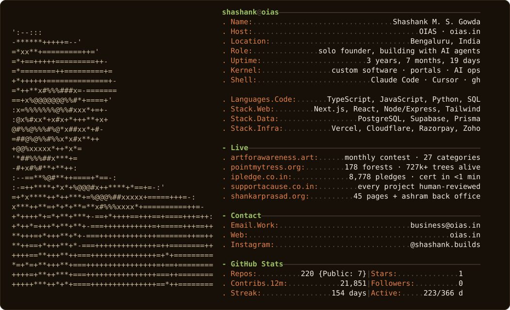
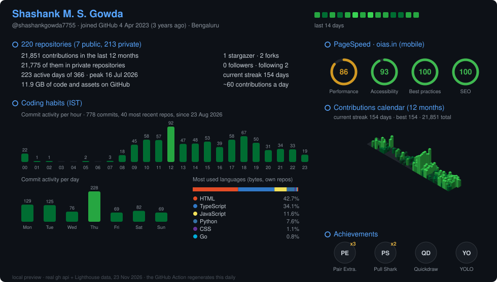
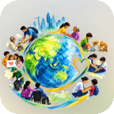
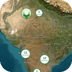
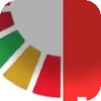
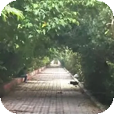
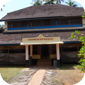
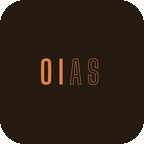

<picture>
  <source media="(prefers-color-scheme: dark)" srcset="assets/neofetch-dark.svg">
  <source media="(prefers-color-scheme: light)" srcset="assets/neofetch-light.svg">
  
</picture>

### about

I'm Shashank. I run [OIAS](https://oias.in) from Bengaluru, mostly on my own, with AI agents doing a lot of the typing and me doing the deciding and the checking.

Most of what I build is for causes: a drawing competition open to every age in India, a tree registry that keeps publishing the trees that died, a pledge site that hands you a certificate in under a minute, and a crowdfunding site where a person reads every project before it can take money. OIAS also builds custom software and booking and registration portals for other teams.

Nearly all of it runs in private repos, because it runs live products with real people's data. That's why the graph is green and the repo list is short.

### now

- **Art for Awareness** · November theme *Mountains Give Us Life*. Entries close 30 Nov, results on 8 Dec 2026.
- **iPledge** · 8,778 pledges taken. Next mark: 10,000.
- **oias.in** · booking a call writes straight to Zoho CRM; agents draft outreach inside a daily limit I set.

### live systems

<table>
<tr>
<td width="50%" valign="top">

<b><a href="https://artforawareness.art">Art for Awareness</a></b> 
<code>27 categories</code> <code>Node · Postgres</code> 
Monthly drawing contest. Blind jury, results on a fixed day, a certificate for every entry. Run by OIAS, a COMMUNITREE initiative.
</td>
<td width="50%" valign="top">

<b><a href="https://pointmytress.org">Point My Trees</a></b> 
<code>178 forests</code> <code>727k+ trees alive</code> 
A life record for every tree: dated visits, photos, survival, on a public satellite map. Dead trees stay on the map. Built for COMMUNITREE.
</td>
</tr>
<tr>
<td width="50%" valign="top">

<b><a href="https://ipledge.co.in">iPledge</a></b> 
<code>8,778 pledges</code> <code>&lt; 1 min</code> 
Pick a pledge, add your name, download a certificate. No login, no OTP. Sponsors watch sign-ups live.
</td>
<td width="50%" valign="top">

<b><a href="https://supportacause.co.in">Support a Cause</a></b> 
<code>human review</code> <code>Razorpay</code> 
Crowdfunding for community projects. A person checks every project first; each volunteer's link credits them automatically.
</td>
</tr>
<tr>
<td width="50%" valign="top">

<b><a href="https://shankarprasad.org">shankarprasad.org</a></b> 
<code>45 pages</code> <code>Next.js · Prisma</code> 
Website and back office for an ashram near Gokarna. Staff edit pages as drafts, then publish. Enquiries, stays and donations in one place.
</td>
<td width="50%" valign="top">

<b><a href="https://oias.in">oias.in</a></b> 
<code>Lighthouse 86 · 93 · 100 · 100</code> 
My own studio site, run the way I tell clients to run theirs: booking → CRM, agent-written follow-ups, a queued blog.
</td>
</tr>
</table>

### tools

### achievements

   

Pair Extraordinaire · Pull Shark · Quickdraw · YOLO

### reach me

